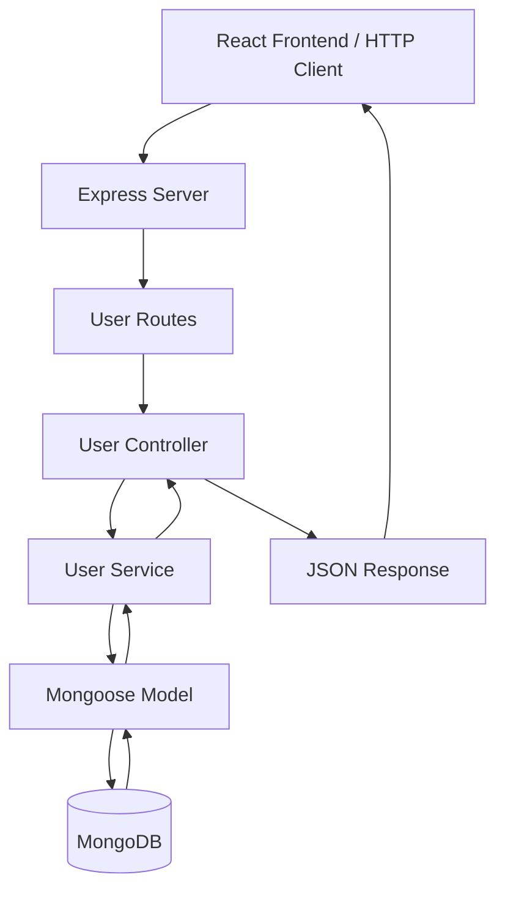

<div align="center">

# USERSCRUD

### Backend REST API

A TypeScript REST API for user management,
built around explicit application layers
and MongoDB document persistence.

**Node.js · Express · TypeScript · MongoDB · Mongoose**

[**Frontend Repository**](https://github.com/0sayo0/usercrud-frontend) ·
[**Developer Portfolio**](https://jonathanmoralesdev.com)

</div>

---

## Overview

**UsersCRUD Backend** is the server-side application
of a full-stack user management project.

It provides REST endpoints for creating, retrieving,
updating, and deleting user records stored in MongoDB.

The project focuses on implementing a layered
Node.js application using Express, TypeScript,
and Mongoose.

Its architecture separates:

- HTTP routing.
- Request handling.
- Application services.
- Database models.
- Database configuration.

The API is consumed by a separate React frontend
that manages the user interface, form validation,
and client-side application state.

---

## Features

### RESTful User Management

The API provides endpoints for:

- Retrieving all users.
- Retrieving a user by ID.
- Creating a user.
- Updating an existing user.
- Deleting a user.

### MongoDB Persistence

User records are persisted in MongoDB
through Mongoose models.

### Schema-Based Data Modeling

Mongoose defines the structure of user documents,
including required fields, defaults,
and field-level constraints.

### Duplicate Email Checking

Before creating a user, the service queries
the database for an existing record with
the supplied email address.

The Mongoose schema also declares a unique
index for the email field.

### Structured JSON Responses

API responses follow a consistent general structure
using a `success` field together with returned data
or an error message.

### HTTP Error Handling

Controllers handle operation failures and
return HTTP status codes for the corresponding outcomes.

---

## Technology Stack

| Category                  | Technologies |
| ------------------------- | ------------ |
| Runtime                   | Node.js      |
| Framework                 | Express 4    |
| Language                  | TypeScript   |
| Database                  | MongoDB      |
| ODM                       | Mongoose 8   |
| Environment Configuration | dotenv       |
| Cross-Origin Requests     | cors         |
| Development Runtime       | tsx          |

---

## Project Architecture

The backend uses a layered structure that
separates HTTP concerns from application
operations and persistence.

```text
usercrud-backend/
│
├── src/
│   ├── config/
│   │   └── db.ts
│   │
│   ├── controllers/
│   │   └── user.controller.ts
│   │
│   ├── interfaces/
│   │   └── user.interface.ts
│   │
│   ├── models/
│   │   └── user.model.ts
│   │
│   ├── routes/
│   │   └── user.routes.ts
│   │
│   ├── services/
│   │   └── user.service.ts
│   │
│   └── app.ts
│
├── package.json
├── tsconfig.json
└── .gitignore
```

### Architectural Responsibilities

**`src/app.ts`**

Configures and starts the Express application.

Responsibilities include:

- Loading environment variables.
- Registering middleware.
- Connecting to MongoDB.
- Mounting API routes.
- Starting the HTTP server.

**`src/config/db.ts`**

Handles the MongoDB connection through Mongoose.

**`src/routes/`**

Defines HTTP endpoints and maps requests
to controller methods.

**`src/controllers/`**

Receives HTTP requests, invokes application services,
and constructs JSON responses.

**`src/services/`**

Encapsulates database-related application operations.

**`src/models/`**

Defines the Mongoose schema and model used
for persistence.

**`src/interfaces/`**

Contains TypeScript interfaces representing
the application's user data.

---

## Request Lifecycle

Each request passes through several
application responsibilities.



### Example: Creating a User

1. The client sends a POST request to `/api/users`.
2. Express matches the request to the user routes.
3. The route invokes `UserController.createUser`.
4. The controller delegates the operation to `UserService`.
5. The service checks whether the email is already registered.
6. A Mongoose model is created from the submitted data.
7. Mongoose validates and saves the document in MongoDB.
8. The saved record is returned to the controller.
9. The controller responds with HTTP `201` and the new user.

---

## API Reference

Base URL:

```text
http://localhost:5000/api/users
```

### Endpoints

| Method | Endpoint         | Description           |
| ------ | ---------------- | --------------------- |
| GET    | `/api/users`     | Retrieve all users    |
| GET    | `/api/users/:id` | Retrieve a user by ID |
| POST   | `/api/users`     | Create a user         |
| PUT    | `/api/users/:id` | Update a user         |
| DELETE | `/api/users/:id` | Delete a user         |

---

### GET — Retrieve All Users

```http
GET /api/users
```

Successful response:

```json
{
  "success": true,
  "data": [
    {
      "_id": "507f1f77bcf86cd799439011",
      "name": "Alex Rivera",
      "email": "alex@example.com",
      "age": 27,
      "role": "developer"
    }
  ]
}
```

---

### GET — Retrieve User by ID

```http
GET /api/users/:id
```

Successful response:

```json
{
  "success": true,
  "data": {
    "_id": "507f1f77bcf86cd799439011",
    "name": "Alex Rivera",
    "email": "alex@example.com",
    "age": 27,
    "role": "developer"
  }
}
```

If the user does not exist:

```json
{
  "success": false,
  "message": "Usuario no encontrado"
}
```

HTTP status: `404`.

---

### POST — Create User

```http
POST /api/users
Content-Type: application/json
```

Request body:

```json
{
  "name": "Alex Rivera",
  "email": "alex@example.com",
  "age": 27,
  "role": "developer"
}
```

Successful response:

```json
{
  "success": true,
  "data": {
    "_id": "507f1f77bcf86cd799439011",
    "name": "Alex Rivera",
    "email": "alex@example.com",
    "age": 27,
    "role": "developer"
  }
}
```

HTTP status: `201`.

If the email is already registered,
the service throws an error handled
by the controller.

---

### PUT — Update User

```http
PUT /api/users/:id
Content-Type: application/json
```

Example request:

```json
{
  "name": "Alex R. Rivera",
  "role": "senior developer"
}
```

The update operation uses Mongoose
with the following options:

```ts
{
  new: true,
  runValidators: true
}
```

This returns the updated document and
applies configured schema validators
during the update operation.

---

### DELETE — Remove User

```http
DELETE /api/users/:id
```

Successful response:

```json
{
  "success": true,
  "message": "Usuario eliminado correctamente"
}
```

If the user does not exist, the
controller returns HTTP `404`.

---

## Data Model

The application defines its user model
using TypeScript and Mongoose.

### TypeScript Interface

```ts
interface IUser {
  name: string;
  email: string;
  age: number;
  role?: string;
  createdAt?: Date;
}
```

### MongoDB Document Schema

| Field       | Type   | Configuration                        |
| ----------- | ------ | ------------------------------------ |
| `name`      | String | Required, trimmed                    |
| `email`     | String | Required, unique, trimmed, lowercase |
| `age`       | Number | Required                             |
| `role`      | String | Default: `user`                      |
| `createdAt` | Date   | Generated automatically              |
| `updatedAt` | Date   | Generated automatically              |

The Mongoose schema enables timestamps
and disables the version key.

---

## Engineering Decisions

### Express for HTTP Routing

Express provides the HTTP application layer,
middleware configuration, and REST endpoint routing.

### TypeScript

TypeScript defines application contracts and
enables static checking across controllers,
services, interfaces, and models.

### Layered Application Structure

Routing, controllers, services, and models
have separate responsibilities.

This makes the request flow explicit and
reduces the amount of persistence logic
inside HTTP controllers.

### Mongoose as an ODM

Mongoose provides schema definitions,
document validation, and database operations.

The service layer uses Mongoose methods
such as:

- `find`
- `findById`
- `findOne`
- `save`
- `findByIdAndUpdate`
- `findByIdAndDelete`

### JSON API Responses

Controllers return structured JSON responses
to communicate operation results to clients.

### Separate Frontend and Backend

The React application and Express API are
maintained in independent repositories.

This separation makes the boundary between
user interface and server-side persistence explicit.

---

## Getting Started

### Prerequisites

- Node.js and npm.
- A running MongoDB instance or MongoDB Atlas database.
- A MongoDB connection URI.

### 1. Clone the Repository

```bash
git clone https://github.com/0sayo0/usercrud-backend.git
cd usercrud-backend
```

### 2. Install Dependencies

```bash
npm ci
```

### 3. Configure Environment Variables

Create a `.env` file in the project root.

For a local MongoDB instance:

```env
PORT=5000
MONGO_URI=mongodb://127.0.0.1:27017/usercrud
```

Replace `MONGO_URI` with the connection string
for your own database when using another environment.

Never commit database credentials or connection
strings containing passwords.

**Security notice:** Database credentials must be
provided through environment configuration.
Any credentials previously embedded in source code
must be revoked and removed, including from
public Git history.

### 4. Start the Development Server

```bash
npm run dev
```

By default, the API listens on port `5000`.

### 5. Test an Endpoint

Using a browser or an HTTP client, request:

```http
GET http://localhost:5000/api/users
```

This endpoint retrieves the user collection
from the configured MongoDB database.

---

## Available Scripts

| Command         | Description                               |
| --------------- | ----------------------------------------- |
| `npm run dev`   | Run the API in development mode using tsx |
| `npm run build` | Compile TypeScript into `dist/`           |
| `npm run start` | Execute the compiled application          |

---

## HTTP Response Codes

The controllers currently use the following
response statuses:

| Status | Meaning                                   |
| ------ | ----------------------------------------- |
| `200`  | Successful retrieval, update, or deletion |
| `201`  | User successfully created                 |
| `400`  | Creation or update request failed         |
| `404`  | Requested user was not found              |
| `500`  | Server-side operation failed              |

The exact status depends on the controller
and the operation being performed.

---

## Current Scope

UsersCRUD Backend is a project focused on
REST API implementation and MongoDB persistence.

It demonstrates:

- Express routing.
- TypeScript-based server development.
- Controller and service separation.
- Mongoose schemas and models.
- Database CRUD operations.
- JSON response handling.

The current implementation does not include:

- Authentication or authorization.
- Automated API tests.
- A centralized error-handling middleware.
- Pagination or advanced filtering.
- API rate limiting.

The API should not be exposed as a public
user-management service without additional
security and operational controls.

---

## Related Repository

### UsersCRUD Frontend

The React frontend provides the interface
for creating, viewing, editing, searching,
and deleting user records.

It communicates with this API through Axios.

[**Explore Frontend Repository →**](https://github.com/0sayo0/usercrud-frontend)

---

## Author

**Jonathan Saúl Morales Espinosa**

Full Stack Software Developer

[Portfolio](https://jonathanmoralesdev.com) ·
[GitHub](https://github.com/0sayo0) ·
[LinkedIn](https://www.linkedin.com/in/jonathan-morales-dev/)

---

<div align="center">

**USERSCRUD / BACKEND**

_Explicit API boundaries. Layered responsibilities.
Persistent data._

</div>
